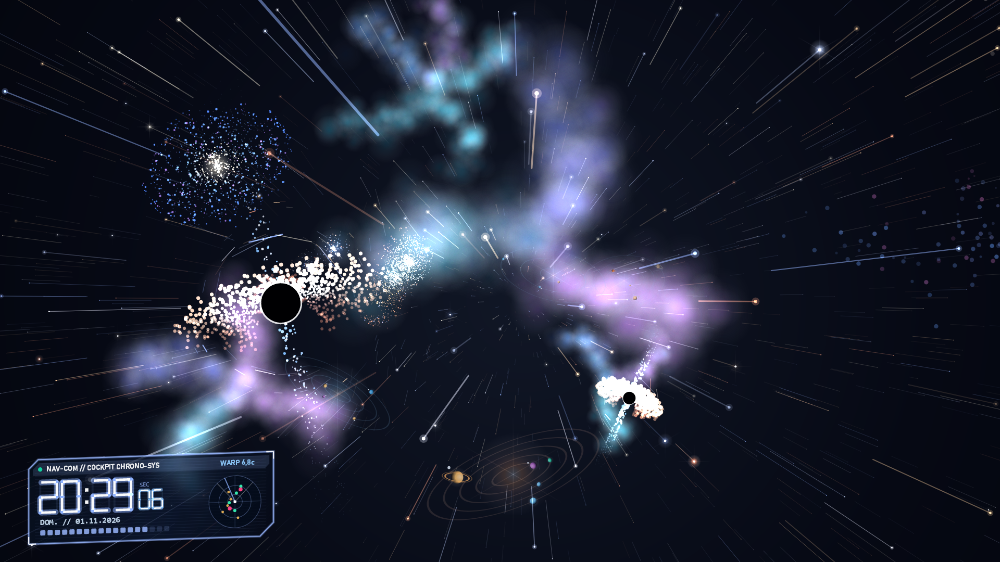
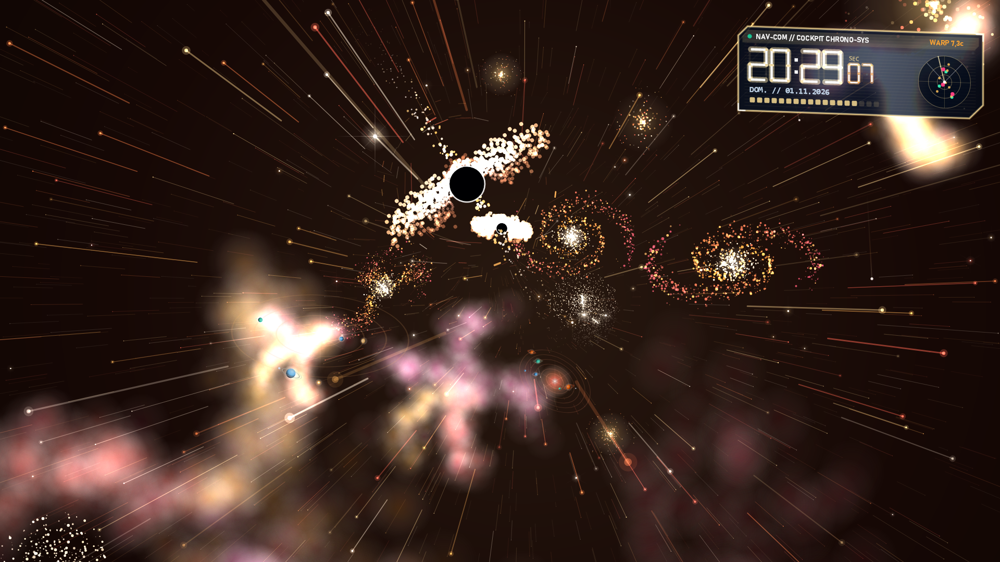

# Cosmos .NET — Salvapantallas Espacial 3D (Rama: `feature/puntos-de-luz`)

Salvapantallas interactivo y procedural para Windows desarrollado en **.NET 9 (WPF + SkiaSharp)** con simulación física y matemática en tiempo real mediante **puntos de luz (point lights)**.

> [!NOTE]
> **100% Matemático — Cero GIFs y Cero Mapas de Bits (Bitmaps)**  
> En esta rama se han eliminado por completo las texturas estáticas, GIFs y bitmaps pre-renderizados. Cada estrella, nebulosa, brazo galáctico y agujero negro se calcula matemáticamente fotograma a fotograma como enjambres de puntos de luz regidos por física gravitacional y óptica relativista.

---

## 📸 Capturas de la Simulación Matemática de Puntos de Luz (1080p)

### 1. Enjambres Relativistas de Puntos de Luz (Agujero Negro, Galaxias y Nebulosas)


### 2. Disco de Acreción con Efecto Doppler Beaming y Lente Gravitacional de Einstein


---

## 🔬 Modelos Matemáticos y Procesos Implementados

* **Agujeros Negros (Mecánica Relativista por Puntos de Luz)**:
  * **Disco de Acreción Kepleriano**: Más de 1.100 puntos de luz individuales orbitando la singularidad con velocidad angular relativista $\Omega(r) = \frac{v_0}{r^{1.5}}$ y perfil térmico $T(r) \propto r^{-3/4}$.
  * **Efecto Doppler Relativista (Beaming)**: Las partículas que giran en dirección al observador sufren amplificación de brillo $\delta^{2.8}$ y desplazamiento al azul/blanco ultracaliente, mientras que las que se alejan se atenúan y se desplazan al rojo.
  * **Lente Gravitacional de Einstein en el propio disco**: La luz de las partículas situadas detrás del horizonte se curva sobre y bajo la esfera negra siguiendo la métrica de Schwarzschild, creando el arco gravitacional superior e inferior característico de *Gargantua*.
  * **Esfera de Fotones ($r = 1.5 r_s$)**: Anillo fino y ultrabrillante de fotones en órbita inestable.
  * **Jets Polares Helicoidales**: Eyección relativista de partículas que giran en espiral a lo largo de líneas de campo magnético.
* **Estrellas y Vuelo Hiperespacial 3D**:
  * Puntos de luz 3D $(X, Y, Z)$ con atenuación fotométrica según la ley del inverso del cuadrado $I \propto 1/Z^2$.
  * Integración de estelas Warp a lo largo de la trayectoria de avance de la nave.
  * Desviación gravitacional de Einstein por cada rayo estelar que pasa cerca de un agujero negro en pantalla ($\Delta \vec{x} \propto r_E^2 / d^2$).
* **Galaxias por Ondas de Densidad Espirales**:
  * Miles de estrellas / puntos de luz individuales generados según la ecuación de espiral logarítmica $r(\theta) = a \cdot e^{b\theta}$ con dispersión gaussiana perpendicular y curva de rotación galáctica plana (materia oscura).
* **Nebulosas Volumétricas**:
  * Nubes de puntos de luz de gas ionizado con deriva armónica tridimensional y gradientes radiales continuos sin bordes duros.
* **Panel Holográfico de Cabina Sci-Fi**:
  * Reloj vectorial de gran formato con dígitos futuristas de 7 segmentos.
  * Radar 3D con barrido en vivo de sistemas y singularidades cercanas.
  * **Protección Anti-Burn-in**: Rotación automática periódica entre las cuatro esquinas de la pantalla para paneles OLED y pantallas de salón.

---

## 🛠️ Tecnologías

* **.NET 9.0 (`net9.0-windows`)**
* **C# 13**
* **SkiaSharp** (renderizado vectorial acelerado con blending aditivo `SKBlendMode.Plus`)
* **WPF** (gestión multi-monitor, interop Win32 `/s`, `/c`, `/p` y GUI de configuración)

---

## 📦 Compilación

Para compilar y empaquetar los ejecutables finales (`CosmosScreensaver.scr` y `CosmosInstaller.exe` en `dist/`):

```powershell
powershell -ExecutionPolicy Bypass -File .\scripts\build-release.ps1
```
